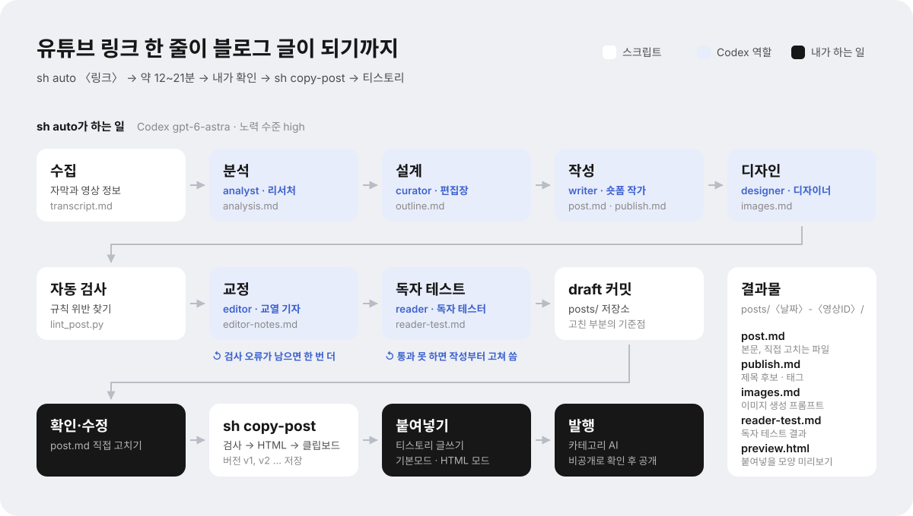

# blog-automation

유튜브 링크 하나로 **공부용 블로그 글 초안**을 만드는 프로젝트입니다. 영상을 요약하지 않고 재창조해서, 영상을 안 본 사람도 숏폼처럼 슥슥 읽으며 공부할 수 있는 글을 만듭니다.

터미널에서 `sh auto <유튜브 링크>` 한 줄이면 Codex가 역할 6개를 차례로 맡아 글을 쓰고, `sh copy-post`로 티스토리에 붙여넣을 HTML을 복사합니다.

## 한눈에 보는 흐름

<picture>
  <source media="(prefers-color-scheme: dark)" srcset="docs/pipeline-dark.svg">
  
</picture>

흐름도는 `docs/make_pipeline_svg.py`로 만듭니다. 파이프라인이 바뀌면 이 파일을 고치고 `.venv/bin/python docs/make_pipeline_svg.py`를 실행합니다.

- **스크립트**가 하는 일: 자막 수집, 자동 검사, git 커밋, HTML 변환 (네트워크와 git이 필요한 일)
- **Codex**가 하는 일: 역할 6개 (분석, 설계, 작성, 디자인, 교정, 독자 테스트). 역할마다 `codex exec`를 따로 실행해 역할이 섞이지 않습니다
- **사람**이 하는 일: 초안 확인·수정, 티스토리에 붙여넣기와 발행 (티스토리 Open API가 종료되어 자동 발행은 할 수 없습니다)
- 최종 검사에서 오류가 남아도 초안은 커밋하고, 어떤 오류인지 터미널에 알려 줍니다

## 1. 준비물

| 항목 | 용도 | 확인 |
|---|---|---|
| macOS | 클립보드 복사 | |
| Python 3.9 이상 | 자막 추출, HTML 변환, 자동 검사 | `python3 --version` |
| Codex CLI | `sh auto` 실행 | `codex --version` |
| git | 버전 기록 | `git --version` |
| GitHub CLI (선택) | 리포 클론, 글 백업 | `gh auth status` |
| Claude Code (선택) | `/write`로 대화하며 만들기 | |

## 2. 설치 (처음 한 번)

```bash
gh repo clone mooonseok/blog-automation
cd blog-automation
python3 -m venv .venv
.venv/bin/pip install -r requirements.txt
```

`.venv`는 git에 올라가지 않으므로, 새 컴퓨터에서 클론했다면 아래 두 줄(`venv`, `pip install`)을 다시 실행합니다.

Codex CLI 설치와 로그인도 처음 한 번만 하면 됩니다. 개인 ChatGPT 계정으로 로그인하면 구독에 포함된 사용량으로 동작합니다.

```bash
npm install -g @openai/codex
```

```bash
codex login
```

## 3. 글 만들기: `sh auto`

```bash
sh auto "https://www.youtube.com/watch?v=u2oDdU6z4Bw"
```

```bash
sh auto "https://youtu.be/u2oDdU6z4Bw" "입문자 대상으로"
```

링크 뒤에 적은 말은 이번 글에만 적용되는 추가 요청입니다. 진행 상황이 터미널에 단계별로 나오고, 마지막에 자동 검사·독자 테스트 결과와 필요한 이미지 수를 알려 줍니다. 같은 영상의 글이 이미 있으면 덮어쓰지 않고 `-2`, `-3` 새 폴더로 만듭니다.

**모델과 노력 수준**: 기본값은 `gpt-6-astra`, 노력 수준 `high`입니다. 바꾸려면 명령 앞에 붙입니다.

```bash
CODEX_EFFORT=xhigh sh auto "https://youtu.be/..."
```

```bash
CODEX_MODEL=gpt-6.1-sol CODEX_EFFORT=medium sh auto "https://youtu.be/..."
```

노력 수준은 `low`, `medium`, `high`, `xhigh`, `max`, `ultra` 중에서 고르며, 모델마다 쓸 수 있는 값이 다릅니다.

### 역할

| 순서 | 역할 | 하는 일 | 만드는 것 |
|---|---|---|---|
| 1 | analyst · 기술 리서처 | 자막 오인식 보정, 주장·근거·용어 정리 | `analysis.md` |
| 2 | curator · 편집장 | 영상의 주인공(도구·개념)을 확실히 설명하도록 설계. 독자 질문 3개(Q1은 항상 "주인공은 무엇이고 어떻게 동작할까?"), 곁가지 버리기 | `outline.md` |
| 3 | writer · 숏폼 교육 콘텐츠 작가 | 1~2문장 문단, 질문 → 한 줄 답 → 예시 → 한 줄 정리로 작성 | `post.md`, `publish.md` |
| 4 | designer · 에디토리얼 디자이너 | 요약 상자·팁·단계·표 등 부품 배치, 필요하면 이미지 생성 프롬프트 | `images.md` |
| 5 | editor · 교열 기자 | 자동 검사 결과 반영, 메타 문장·금지 표현 삭제, 분량 조절 | `editor-notes.md` |
| 6 | reader · 독자 테스터 | 영상을 안 본 사람으로서 글만 읽고 주인공과 Q1~Q3를 설명할 수 있는지 확인 | `reader-test.md` |

역할 정의는 `.claude/agents/<역할>.md`, 글쓰기 규칙은 `.claude/skills/blog-style/SKILL.md`, 기준 예시는 `.claude/skills/blog-style/examples/pstack-example.md`입니다.

### 글의 마무리와 이미지 자동화 상태

영상 주제를 새 글로 풀어 쓰며, 자동 출처 목록과 “오늘부터 바로 써먹기/해볼 것” 섹션을 붙이지 않습니다. 본문 설명에 필요한 절차나 비교는 유지합니다. 영상 정보와 근거는 내부 파일에 남습니다.

현재 스크립트는 이미지의 위치·설명·프롬프트(`images.md`)까지 만듭니다. 이미지 생성·호스팅·본문 URL 삽입은 아직 구현하지 않았습니다.

자동화 구현 권장안은 **글 완성 → 이미지 생성 API 호출 → 필요하면 로컬 도식 PNG 렌더링 → 글 폴더에 저장 → 삽입 위치 안내 → 티스토리 기본 이미지 업로드**입니다. 이미지 생성 API 외의 유료 외부 도구·호스팅은 추가하지 않습니다.

- 이미지 생성: Codex 내장 기능을 검증할 수 있으며, 반복 호출에는 Image API를 사용할 수 있습니다 ([공식 안내](https://learn.chatgpt.com/docs/image-generation)). 현재 CLI는 image_generation 기능이 켜져 있지만 exec에서 실제 생성·저장은 미검증입니다.
- 글자·화살표가 정확해야 하는 도식은 로컬 SVG로 만들고 PNG로 렌더링합니다. 대표 일러스트와 도식을 합해 글당 최대 2장으로 제한합니다.
- 파일은 posts/ 아래 로컬에 저장합니다. 로컬 경로만 HTML에 넣어서는 독자가 이미지를 볼 수 없으므로, 티스토리 편집기의 이미지 업로드로 넣습니다. 추가 유료 호스팅 계정은 필요하지 않습니다. 이 업로드 단계는 현재 수동입니다.
- 생성·파일 정리·캡션·삽입 위치 안내를 우선 자동화하는 방향입니다. 같은 프롬프트의 이미지는 재사용하고 실패해도 글을 보존합니다. 생성·렌더링 연결은 아직 구현 전입니다.

### 결과 파일

결과는 `posts/<날짜>-<영상ID>/` 폴더에 생깁니다. `posts/`는 GitHub에 올라가지 않습니다 (8장).

| 파일 | 내용 |
|---|---|
| `post.md` | **본문**. 직접 고치는 파일 |
| `publish.md` | 카테고리, 제목 후보 3개, 태그 |
| `images.md` | 필요한 이미지와 생성 프롬프트 (있을 때만) |
| `reader-test.md` | 독자 테스트 결과 (PASS/FAIL) |
| `editor-notes.md` | 교정 내용과 직접 판단할 점 |
| `outline.md`, `analysis.md` | 글 설계안, 영상 분석 |
| `transcript.md`, `meta.json` | 원본 자막과 영상 정보 |
| `logs/` | 역할별 Codex 로그와 자동 검사 결과 |
| `preview.html` | 미리보기 (`sh copy-post`가 만듦) |
| `versions/` | 클립보드로 복사한 버전들 (`sh copy-post`가 만듦) |

### 다른 방법

- **Claude Code**: 이 폴더에서 Claude Code를 열고 `/write <유튜브 링크> [추가 요청]`. 같은 역할들이 서브에이전트로 실행됩니다.
- **Codex 대화 화면**: `$write-post <유튜브 링크>`. Codex는 `AGENTS.md`(공통 지침)를 자동으로 읽고, 역할은 `.codex/agents/*.toml` 커스텀 에이전트입니다. 역할별 모델을 바꾸려면 해당 `.toml`의 `model`, `model_reasoning_effort`를 고칩니다.
- 다른 컴퓨터로 옮겨 왔다면 첫 메시지로 "HANDOFF.md와 AGENTS.md를 끝까지 읽어 줘"를 보내세요. 지금까지의 결정과 다음 작업이 정리돼 있습니다.

## 4. 직접 고치기

`post.md`를 편집기로 열어 고칩니다. 아래 주석을 남기면 나중에 문체 학습(`/feedback`, 로드맵)에 쓰입니다. 주석은 복사할 때 자동으로 빠지므로 블로그에는 올라가지 않습니다.

| 주석 | 언제 |
|---|---|
| `<!-- 왜: 결론을 먼저 -->` | 고친 이유가 diff만 봐서는 안 보일 때 |
| `<!-- 왜: ... 전체 적용 -->` | 같은 패턴을 글 전체에 적용하라는 뜻 |
| `<!-- 이 글만 -->` | 이 글에만 해당하는 수정 (규칙으로 만들지 않음) |
| `<!-- 좋음: 비유가 딱 맞음 -->` | 마음에 든 부분 |
| `<!-- 확인 필요 -->` | AI가 남김. 영상에서만 나온, 아직 확인하지 않은 사실. 확인한 뒤 지우거나 고칩니다 |
| `<!-- 내 생각: 직접 한두 줄 추가 -->` | AI가 남김. 마무리 아래 내 의견을 쓸 자리 |

### 부품 문법

본문은 약 18px, 표는 약 17px, 요약 라벨은 약 18px, 요약 핵심 문장은 약 23px로 표시합니다 (Odyssey 스킨 미리보기 기준). 스킨과 편집기 저장 결과에 따라 달라질 수 있습니다.

상자나 단계는 아래 문법으로 쓰면 복사할 때 티스토리 서식으로 바뀝니다. 자세한 규칙은 `blog-style/SKILL.md` 5장에 있습니다.

| 부품 | 문법 | 티스토리에서 보이는 모양 |
|---|---|---|
| 한눈에 보기 | `:::summary` 첫 줄=핵심, `- `=체크, `? `=질문, `:::`로 닫기 | 박스 (인용 style3) |
| 한 줄 정리 | `:::takeaway` 한 문장 (`==구절==`은 형광펜) | 가운데 큰따옴표 (인용 style1) |
| 용어 / 팁 / 주의 | `:::term`, `:::tip`, `:::warn` | 색 라벨이 있는 박스 |
| 발언 인용 | `:::quote 화자` | 세로선 (인용 style2) |
| 번호 단계 | `:::steps` 줄마다 `제목 \| 설명` | ①②③ 번호 줄 |
| 체크리스트 (선택) | `:::checklist` 줄마다 `- 항목` | ☐ 본문 점검 기준. 마무리 행동 과제는 붙이지 않습니다 |
| Q 소제목 | `## Q1. 질문?` | 파란 Q1. + 소제목 |
| 이미지 자리 | `[[이미지 1]]` | 안내 박스 (붙여넣은 뒤 실제 이미지로 바꿈) |
| 표 | 마크다운 표 | 티스토리 표 (style11) |

## 5. 클립보드에 복사: `sh copy-post`

```bash
sh copy-post
```

1. 자동 검사(`tools/lint_post.py`)를 먼저 돌립니다. 오류나 경고가 있으면 결과와 함께 고치는 방법을 묻습니다.
   ```
     a) 자동 수정 (연결어미 뒤 쉼표 등 기계적인 것만, 즉시)
     c) Codex로 교정 (오류·경고 전부, editor 역할로 1~3분)
     y) 이대로 복사
     n) 취소
   ```
   `a`나 `c`로 고치면 다시 검사하고, 고친 내용은 `posts/` 저장소에 `fix: <폴더> …`로 따로 커밋합니다 (내가 고친 부분과 섞이지 않게). 오류·경고가 0개가 되면 바로 다음 단계로 넘어갑니다.
2. `post.md`를 티스토리용 HTML로 바꿔 클립보드에 넣고, 같은 폴더에 `preview.html`(미리보기)을 만듭니다.
3. 필요한 이미지가 있으면 개수와 `images.md` 위치를 알려 줍니다.

**새 글을 처음 복사할 때**는 바로 복사하고 `versions/v1.md`로 저장합니다. **이미 복사한 글이면** 메뉴가 뜹니다. 엔터만 누르면 1번입니다.

```
새 글이 없습니다. 이미 복사한 글: pstack 해부: ... (마지막 v2)
  1) 현재 글 (수정됨 → v3로 저장)
  2) v2  2026-10-28 19:52
  3) v1  2026-10-28 19:52
  o) 다른 글 고르기
  q) 취소
  (엔터 = 1)
```

- **현재 글**: 마지막 버전 이후 고친 게 있으면 다음 버전으로 저장하고 복사합니다. 고친 게 없으면 버전을 올리지 않습니다
- **예전 버전**: 그 버전을 그대로 복사합니다
- **다른 글 고르기**: 전체 글 목록에서 고릅니다

새 버전이 저장되면 `posts/` 로컬 저장소에 `copy: <폴더> vN`으로 자동 커밋합니다. 특정 글을 바로 지정할 수도 있습니다.

```bash
sh copy-post posts/2026-10-28-u2oDdU6z4Bw-6
```

## 6. 티스토리에 붙여넣기

1. 블로그 관리 → **글쓰기** 열기 (`https://<블로그 주소>/manage/newpost`)
2. 본문에 붙여넣기 (`Cmd + V`). **기본모드와 HTML 모드 모두 됩니다.** 마크다운 모드에는 붙여넣지 마세요 (태그가 글자로 보입니다)
3. 이미지가 필요하면 `images.md`의 프롬프트로 만들어, 안내 박스(🖼 이미지 N 자리) 자리에 넣고 박스는 지웁니다
4. **카테고리**: `AI`
5. **제목**: 터미널에 나온 제목 후보 중 하나 또는 직접 작성
6. **태그**: 터미널에 나온 태그 입력
7. **완료** → 공개 설정을 **비공개**로 저장
8. 블로그에서 비공개 글을 열어 미리보기와 같은지 확인
9. 문제가 없으면 공개로 바꿔 발행

붙여넣기 전에 모양을 보고 싶다면 미리보기를 엽니다.

```bash
open posts/<글 폴더>/preview.html
```

> 붙여넣은 뒤 티스토리 편집기에서 글을 고쳤다면, 같은 내용을 `post.md`에도 반영해 두세요. 그래야 다음 버전과 학습 기록이 어긋나지 않습니다.

### 디자인이 깨지지 않는 이유

티스토리 편집기는 붙여넣은 HTML에서 대부분의 스타일(배치, 크기, 테두리, 모서리, 그라데이션, 여백 등)을 지웁니다. 그래서 `sh copy-post`는 **티스토리가 지우지 않는 것만** 씁니다: 티스토리 자체 서식(인용 style1~3, 표 style11, 문단 크기, 빈 문단)과 글자색·배경색. 변환기(`tools/render_post.py`)가 그 밖의 스타일을 미리 지웁니다. 실제 저장 과정에서 서식이 바뀔 수 있으므로 발행 전 결과를 확인합니다.

### 스킨 CSS 한 번 고치기 (선택)

한글이 단어 중간에서 줄바꿈되거나(`새로고침하/니`), 링크가 통째로 다음 줄로 넘어가는 건 블로그 스킨의 설정 때문이라 글 HTML로는 고칠 수 없습니다. 스킨에 한 번만 넣어 두면 모든 글에 적용됩니다.

블로그 관리 → 꾸미기 → 스킨 편집 → html 편집 → CSS 탭의 맨 아래에 붙여넣고 적용합니다.

```css
/* 한글을 단어 단위로 줄바꿈하고, 링크가 통째로 다음 줄로 넘어가지 않게 */
.article-view p, .article-view li, .article-view td { word-break: keep-all; overflow-wrap: break-word; }
.article-view a { display: inline; }
```

## 7. 버전 기록 보기

글의 버전 기록은 `posts/` 저장소에 있으므로 `git -C posts`로 봅니다.

```bash
git -C posts log --oneline -- <글 폴더>
```

- `draft: ...` AI가 만든 초안 (`sh auto`, `/write`)
- `fix: ...` 복사 직전 자동 수정(`a`)이나 Codex 교정(`c`)이 고친 부분 (`sh copy-post`)
- `copy: ... vN` 직접 고쳐서 실제로 복사해 간 버전 (`sh copy-post`)

둘을 비교하면 직접 고친 부분이 나옵니다.

```bash
git -C posts diff <draft 커밋> <copy 커밋> -- <글 폴더>/post.md
```

## 8. 글 저장 위치와 백업

GitHub 리포에는 **도구만** 올라갑니다. 글은 내 컴퓨터에만 저장됩니다.

| | 도구 리포 (이 폴더) | 글 저장소 (`posts/`) |
|---|---|---|
| 내용 | 스크립트, 스킬, 역할, 문서 | 자막, 분석, 본문, 버전 |
| git | GitHub `mooonseok/blog-automation`에 푸시 | 로컬 전용 (원격 없음) |
| 커밋하는 곳 | 도구를 고칠 때 | `sh auto`·`/write`(draft), `sh copy-post`(copy vN) |

`posts/`는 도구 리포의 `.gitignore`에 들어 있어서 실수로 올라갈 일이 없습니다. 도구를 새로 클론하면 `posts/`는 비어 있고, 첫 `sh auto`나 `sh copy-post` 때 자동으로 만들어집니다.

**백업이 필요하다면**, 글 전용 비공개 리포를 따로 만들어 `posts/`에 연결하세요. 연결해 두면 `sh copy-post`가 새 버전을 저장할 때 그 리포로 자동 푸시합니다.

```bash
gh repo create <글 전용 리포 이름> --private --source=posts --push
```

## 9. 문제 해결

| 증상 | 해결 |
|---|---|
| `codex CLI가 없음` | 2장의 Codex 설치와 로그인을 실행하세요 |
| `<역할> 단계 실패` | 글 폴더의 `logs/<역할>.log`에 Codex 오류가 남아 있습니다. 로그인 만료나 사용량 한도가 흔한 원인입니다 |
| `자막 수집 실패` | 자막이 없는 영상이거나 유튜브 요청 제한(429)입니다. 몇 분 뒤 다시 시도하세요. 자막 없는 영상(음성 인식)은 아직 지원하지 않습니다 |
| 최종 검사 "오류 남음" / 복사할 때 오류·경고 | `sh copy-post` 메뉴에서 `a`(쉼표 같은 기계적 수정) 또는 `c`(Codex 교정). 직접 고치려면 터미널에 나온 줄 번호를 보세요. 자동 수정만 따로: `.venv/bin/python tools/lint_post.py --fix posts/<폴더>` |
| 독자 테스트 실패 | `reader-test.md`의 "막힌 곳"을 보고 해당 문단을 고치세요 |
| `.venv/bin/python: No such file` | 2장의 `venv`, `pip install`을 실행하세요 |
| `/write`가 명령으로 인식되지 않음 | 이 폴더에서 Claude Code를 열었는지 확인하세요. 이미 열려 있었다면 새 세션을 여세요 |
| "여러 글이 일치함" | `sh copy-post`에 폴더 경로를 그대로 주세요 (`posts/<폴더>`) |
| 붙여넣었는데 `<p ...>` 같은 태그가 글자로 보임 | 마크다운 모드에 붙여넣은 경우입니다. 본문을 지우고 기본모드나 HTML 모드에서 다시 붙여넣으세요 |
| 붙여넣은 모양이 미리보기와 다름 | 어떤 부분이 다른지 캡처해 두세요. `tools/render_post.py`의 `ALLOWED_STYLES`를 조정해야 합니다 |
| 한글이 단어 중간에서 줄바꿈됨 | 6장의 "스킨 CSS 한 번 고치기"를 참고하세요 |
| "푸시 실패" (백업 리포를 연결한 경우) | 커밋은 됐습니다. 네트워크와 로그인을 확인한 뒤 `git -C posts push`를 실행하세요 |

## 10. 폴더 구조

```
auto                         sh auto: 링크 하나로 초안까지 (Codex)
copy-post                    sh copy-post: 검사 → HTML 복사 → 버전 기록
docs/
  make_pipeline_svg.py       README 흐름도(라이트·다크 SVG) 생성
tools/
  render_post.py             마크다운(+부품 문법) → 티스토리 HTML, 미리보기
  lint_post.py               글쓰기 규칙 자동 검사 (--fix: 기계적 자동 수정)
  set_clipboard_html.js      클립보드에 서식·소스를 함께 넣기 (macOS)
.claude/
  agents/                    역할 6개 정의 (analyst, curator, writer, designer, editor, reader)
  skills/blog-style/         글쓰기 규칙, 기준 예시, 출처, 변경 이력
  skills/youtube-transcript/ 자막 추출 스크립트
  commands/write.md          Claude Code용 /write
.codex/agents/               Codex 커스텀 에이전트 (위 역할 파일을 읽음)
.agents/skills/              Codex용 스킬 (blog-style·youtube-transcript는 링크, write-post)
posts/                       글 저장소 (로컬 전용 git, GitHub에 안 올라감)
AGENTS.md                    Codex·Claude 공통 지침
CLAUDE.md                    Claude Code 지침 (AGENTS.md를 불러옴)
HANDOFF.md                   지금까지의 결정과 현재 상태 (인수인계)
```

## 11. 함께 쓰는 전역 스킬

이 컴퓨터에는 디자인용 스킬이 전역으로 설치돼 있습니다. Claude Code와 Codex 모두에서 쓸 수 있고, 리포에는 들어 있지 않습니다. 새 컴퓨터에서는 아래 명령으로 다시 설치합니다.

| 스킬 | 하는 일 | 이 프로젝트에서 쓴 곳 |
|---|---|---|
| `design-taste-frontend` ([taste-skill](https://github.com/Leonxlnx/taste-skill)) | 뻔한 AI 디자인 대신 근거 있는 디자인, 하우스 규칙 | README 흐름도 재디자인 |
| `awesome-design-md` ([VoltAgent](https://github.com/voltagent/awesome-design-md)) | 브랜드 87곳의 색·폰트·간격 규칙 모음 | 흐름도 색 (Vercel·Linear) |
| `agent-browser` ([Vercel](https://github.com/vercel-labs/agent-browser)) | 실제 브라우저로 열고 스크린샷 | 흐름도 렌더링 확인 |
| `web-design-guidelines` ([Vercel](https://github.com/vercel-labs/agent-skills)) | UI 가이드라인 위반 검사 | 블로그 HTML 검사 → 둥근따옴표, 캡션 대비 개선 |
| `screenshot-to-code` ([OneWave-AI](https://github.com/OneWave-AI/claude-skills)) | 스크린샷을 코드로 | 아직 안 씀 |
| `humanize-korean` 외 3개 ([im-not-ai](https://github.com/epoko77-ai/im-not-ai)) | 한국어 AI 티 85개 패턴 진단·윤문 | **`sh auto` 글쓰기 단계** — writer·editor가 규칙집을 읽고 처음부터 AI 티 없이 씀, 자동 검사가 신호 7개 검사 |

```bash
npx skills add Leonxlnx/taste-skill -s design-taste-frontend -g -a claude-code codex -y
npx skills add vercel-labs/agent-skills -s web-design-guidelines -g -a claude-code codex -y
npx skills add vercel-labs/agent-browser -s agent-browser -g -a claude-code codex -y
npx skills add OneWave-AI/claude-skills -s screenshot-to-code -g -a claude-code codex -y
npx skills add epoko77-ai/im-not-ai -s '*' -g -a claude-code codex -y
npm i -g agent-browser && agent-browser install
```

`awesome-design-md`는 스킬이 아니라 파일 모음이라, `~/.agents/skills/awesome-design-md/`에 저장소를 받고 사용법을 적은 `SKILL.md`를 직접 만들어 두었습니다 (`~/.claude/skills`에 링크).

## 12. 로드맵

- [x] 자막 수집, 역할별 글쓰기 파이프라인 (`sh auto`, `/write`, `$write-post`)
- [x] 재창조 글쓰기 규칙, 주인공 설명 필수, 부품 디자인, 자동 검사, 독자 테스트
- [x] `sh copy-post` 버전 관리, 티스토리가 지우지 않는 서식으로 HTML 변환
- [ ] `/feedback`: 내가 고친 부분(`draft`와 `copy vN`의 차이, 주석)으로 글쓰기 규칙 학습
- [ ] 팩트체크: "확인 필요" 사실을 웹으로 검증 (`claims.json`)
- [ ] `/audit`: 예전 글을 정기적으로 재검증하고 빈 주제·업데이트 알림
- [ ] 자막 없는 영상용 음성 인식(Whisper)
